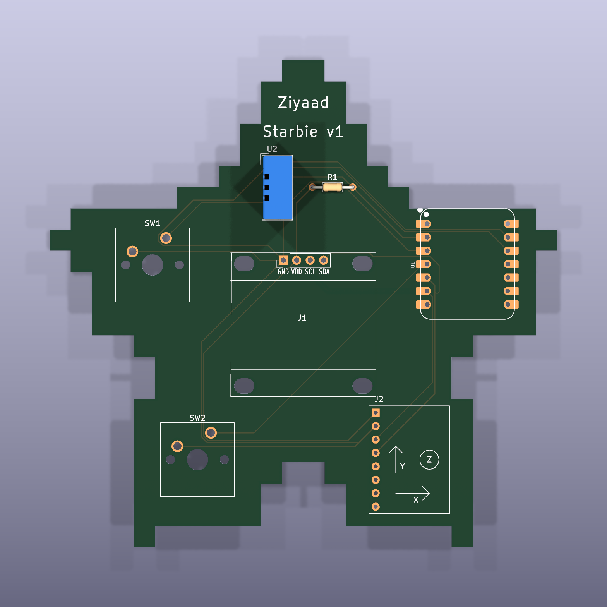
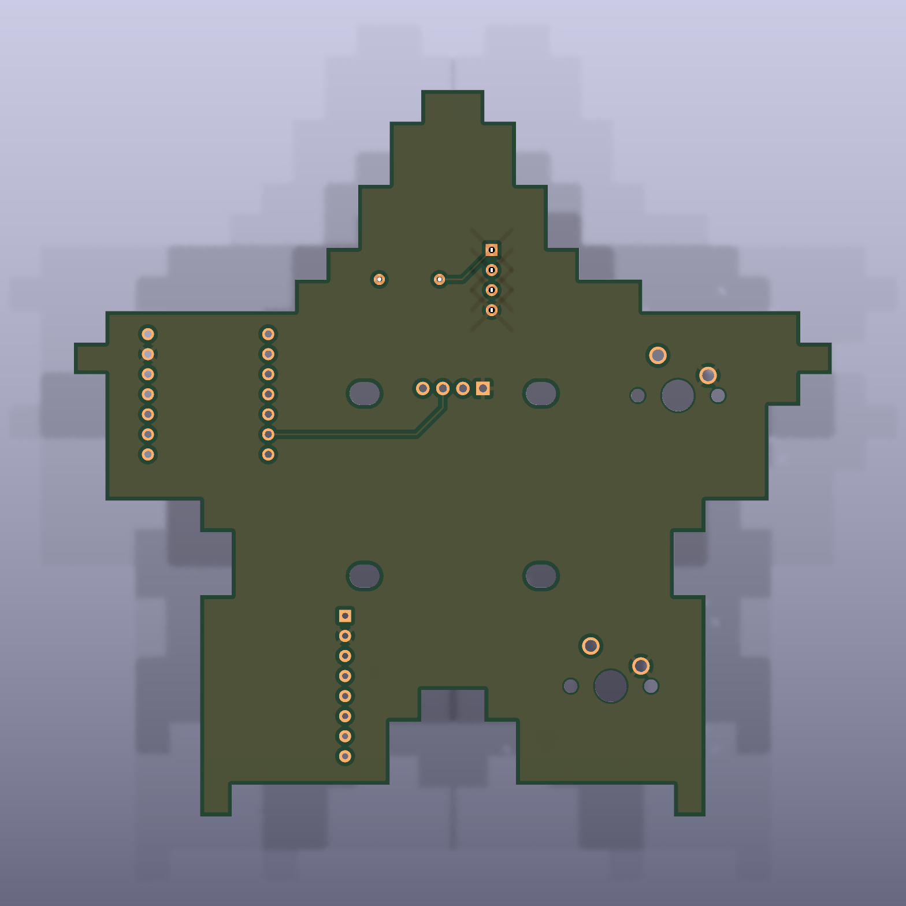
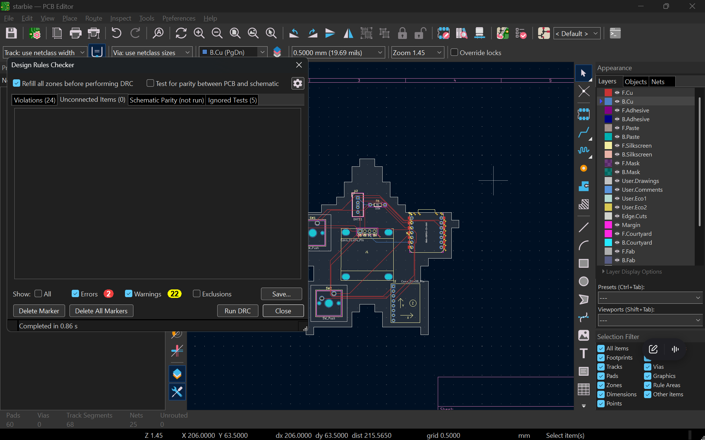
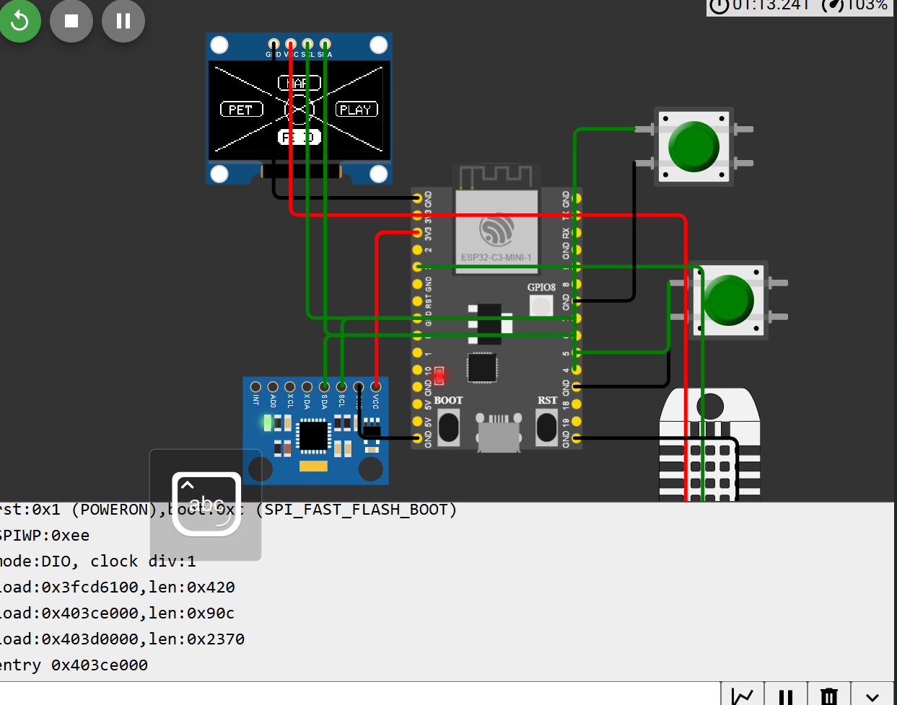

# Starbie

a tiny motion-controlled desk pet on a pixel-star PCB, basically a desktop tamagotchi (totally not a starboy). except mine also tells the time, checks the weather, and clicks your slides.

built for [Hack Club Half Life](https://halflife.hackclub.com), week 1. this is my first PCB ever.

## what it does

starbie has 3 apps. **hold button 2** (about half a second) to switch between them.

| app | what it does | button 1 | tap button 2 |
| --- | --- | --- | --- |
| **pet** | the og starbie. wanders around the screen, reacts when you shake it | opens the radial menu (nap / play / feed / pet), tilt to pick | shows stats |
| **desk** | clock, date, outside weather, room temp + humidity | refresh weather | - |
| **remote** | bluetooth slide clicker for presentations | next slide | previous slide |

the weather comes from [Open-Meteo](https://open-meteo.com), which doesn't need an api key, so there's nothing secret in this repo.

## hardware

| part | job |
| --- | --- |
| Seeed XIAO ESP32-C3 | the brain (wifi + bluetooth) |
| 0.96" SSD1306 OLED | starbie's face |
| MPU6050 | tilt + shake sensing |
| DHT11 + 10k resistor | room temp and humidity |
| 2x Cherry MX switches | the buttons |

the board is a pixel star, about 96 x 92 mm, with the usb-c sticking out of the right arm so you can actually plug it in.

(back side: the ground pour, plus the 2 traces i had to move to the back layer)

## how i built it

1. **schematic** in kicad. first time ever, made a lot of mistakes (wrong chip, using labels instead of power symbols for ground) but got it clean.
2. **pixel star outline** and placed the parts inside the arms.
3. **routing.** did everything on the front first, DRC found 2 broken connections, fixed them on the back layer.
4. **ground pour + my name** on the silkscreen, then exported the gerbers.
5. **simulated it in [Wokwi](https://wokwi.com)** before ordering anything, so if something breaks on the real board i know it's hardware, not code.

the full story (with all the mistakes) is in [JOURNAL.md](JOURNAL.md).

## flashing the firmware

1. install the [Arduino IDE](https://www.arduino.cc/en/software)
2. add the esp32 boards url in **File > Preferences**:
   `https://espressif.github.io/arduino-esp32/package_esp32_index.json`
3. **Tools > Board > Boards Manager**, install **esp32 by Espressif**, pick **XIAO_ESP32C3**
4. install these libraries: Adafruit GFX, Adafruit SSD1306, Adafruit MPU6050, DHT sensor library (click install all for dependencies)
5. open `firmware/StarbieCustom/StarbieCustom.ino`

**before uploading to the real board** (the defaults are set for the simulator):

- set `DHT_SENSOR_TYPE` to `DHT11`
- set `ENABLE_BLE_REMOTE` to `1`
- copy `secrets.example.h` to `secrets.h` and put your wifi in it (it's gitignored so your password never gets pushed)
- **Tools > Partition Scheme > Huge APP**, because wifi + bluetooth together don't fit the default layout
- change the weather location (it's set to Manila)

## files

| path | what's in it |
| --- | --- |
| `starbie.kicad_sch` / `starbie.kicad_pcb` | schematic and board |
| `libs/` | the care package symbols, footprints and 3d models (so the project opens anywhere) |
| `gerbers/` + `starbie-gerbers.zip` | fab files, upload the zip to JLCPCB etc |
| `firmware/StarbieCustom/` | the firmware |
| `images/` + `journal/` | renders and build screenshots |

## status

- [x] schematic, pcb, gerbers
- [x] stock firmware tested in wokwi
- [ ] custom apps (desk + remote) fully tested
- [ ] order the board
- [ ] solder it and flash the real thing

## credits

based on [Starbie](https://github.com/SharKingStudios/Starbie) by Logan Peterson / SharKingStudios (MIT license, see `firmware/LICENSE-starbie-original.txt`) and the Half Life week 1 guide.
